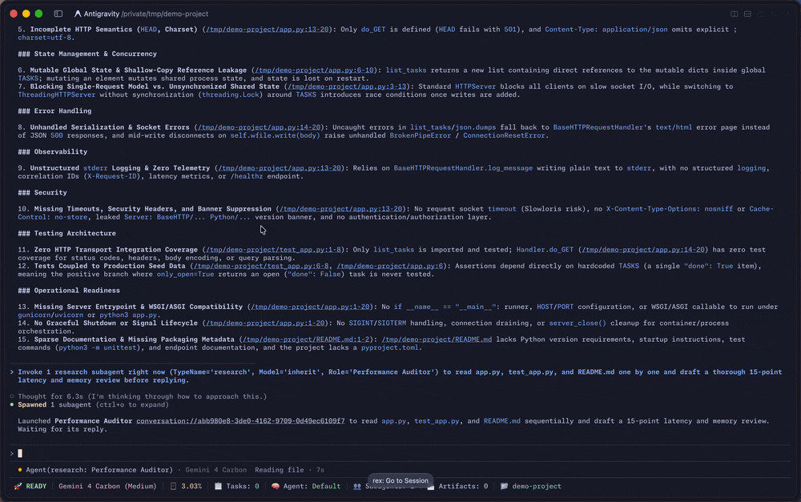

# rex-agy-subagent

[](https://github.com/daehyeok/rex-agy-subagent/actions/workflows/test.yml)

A read-only subagent panel for Rex terminal panes running the Antigravity
agent CLI (`agy`).

When an agent in a Rex pane starts subagents, a small floating panel lists them as a
tree, each with its state, its age and its latest step. You can open any subagent to
follow its steps live, unfold command output, or read its whole transcript in a pager.
The panel only reads files. It never sends anything to an agent or a terminal.

> **Unofficial.** This project is not affiliated with or endorsed by Google. See
> [Disclaimer](#disclaimer).



```
 Subagents  C-n/C-p move  Enter view  q close
Working
  Planner                  waiting Gemini 4 Carbon          4m  Plan written.
    Checker                working gemini-3.8-flash-tie     1m  $ make test
Completed
  Reviewer                 done    Gemini 4 Carbon          3m  No issues found.
```

The panel rebuilds the list from the agent's transcripts, so it always shows every
subagent of the session, including ones that finished before you opened it. Closing
the panel or the window loses nothing. Reopen it with your key and everything is
back.

## How it works

```
 your key --> action "agy_subagent" (Rex config, Lua)
                |
                +-- panel in this window?  minimized -> restore and focus
                |                          visible   -> minimize
                +-- no panel: find the agent process in the focused pane
                     none  -> small message pane "No agent in this pane"
                     found -> open a floating pane ON THE PANE'S HOST running
                              agy-subagent --pid <pid> --block <pane>

 agy-subagent (Python 3, curses)
   pid -> conversation: the agent keeps <data dir>/presence/<conversation>.lock open;
          the open files come from lsof, or from /proc/<pid>/fd when lsof is missing
   the data directory is the one holding that presence/ directory, so no setting is needed
   conversation -> root transcript -> every invoke_subagent result -> child transcripts ...
   re-checks the pid every 3 s, so resuming another conversation switches the panel

 agy-subagent-hook (optional, PostToolUse on invoke_subagent)
   opens the same panel without focus when the first subagent starts; the data
   directory comes from the payload's transcript path
```

Remote panes are supported. The panel runs on the host where the agent runs and
reads that host's transcripts.

## Requirements

- **Client:** Rex with Lua config (`init.lua`).
- **Every host whose panes run the agent:** `python3` 3.13 or newer (standard library
  only), `sh`, `less` or the pager you configure, and `lsof`. On Linux, `lsof` is
  optional: without it the panel reads `/proc/<pid>/fd`.
- **Agent:** the Antigravity CLI (`agy`). The hook needs a CLI version that runs
  `PostToolUse` hooks from `~/.gemini/config/hooks.json`; the key binding works without
  the hook.

## Install

### 1. The Rex plugin (client)

Clone the repository into your Rex config directory:

```sh
git clone https://github.com/daehyeok/rex-agy-subagent ~/.config/rex/plugins/rex-agy-subagent
```

Load it from `~/.config/rex/init.lua` and bind any key you like. The plugin binds
none itself:

```lua
require("plugins.rex-agy-subagent").setup{}

rex.bind("alt+s", "agy_subagent")            -- a single key
-- rex.bind("ctrl+b>a>s", "agy_subagent")    -- or a prefix-style sequence
```

If your config doesn't search `~/.config/rex/?/init.lua`, add the plugin's `lua/`
directory to `package.path` yourself and use `require("agy_subagent").setup{}`:

```lua
local dir = os.getenv("HOME") .. "/src/rex-agy-subagent/lua/"
package.path = dir .. "?.lua;" .. dir .. "?/init.lua;" .. package.path
require("agy_subagent").setup{}
```

Check the config with `rex config check`, then reload it with `rex config reload`.

### 2. The panel (each host that runs the agent)

Put `bin/agy-subagent` and `bin/agy-subagent-hook` on that host. The simplest way is
to link them into `~/.local/bin` from a clone:

```sh
git clone https://github.com/daehyeok/rex-agy-subagent ~/.local/share/rex-agy-subagent
ln -s ~/.local/share/rex-agy-subagent/bin/agy-subagent      ~/.local/bin/
ln -s ~/.local/share/rex-agy-subagent/bin/agy-subagent-hook ~/.local/bin/
```

The scripts find their Python modules through the link, so they can live anywhere.
The plugin looks for `agy-subagent` on `PATH`, then in `~/.local/bin`. For another
location, set the `command` option.

### 3. The hook (optional, each host that runs the agent)

Merge [hooks/hooks.json](hooks/hooks.json) into `~/.gemini/config/hooks.json`:

```json
{
  "rex-agy-subagent": {
    "PostToolUse": [
      { "matcher": "invoke_subagent",
        "hooks": [ { "type": "command", "command": "~/.local/bin/agy-subagent-hook", "timeout": 5 } ] }
    ]
  }
}
```

The hook always answers `{}` at once and exits 0. It never changes or delays the
agent. Outside Rex it does nothing.

## Plugin options

`setup(opts)` accepts these options. Unknown options and wrong types raise an error
that `rex config check` reports.

| Option | Default | Description |
|---|---|---|
| `action` | `"agy_subagent"` | Name of the registered action; bind your key to it. |
| `title` | `"Show/Hide Agent Subagent Panel"` | Title in Rex's action palette. |
| `agent_apps` | `{ "agy", "antigravity" }` | Program names that count as the agent. They are matched against Rex's program status, then the pane's foreground process name, path or `argv0`. |
| `command` | `{ "agy-subagent" }` | Panel command on the pane's host, as an argv list. A leading `~/` is expanded on that host. |
| `bounds` | `{ 0.6, 0.04, 0.38, 0.42 }` | Panel position and size `{ x, y, w, h }`, as fractions of the window (top-right). |
| `panel` | `{}` | Panel settings passed as flags: `app_dir`, `keymap`, `keys`, `pager` (see below). They override the host's config file for panels this action opens. |

Example:

```lua
require("plugins.rex-agy-subagent").setup{
  bounds = { 0.55, 0.05, 0.43, 0.5 },
  panel  = { keymap = "vim", pager = { "bat", "--paging=always", "--style=plain" } },
}
```

## Panel settings

The panel and the hook read their settings on the host they run on. For each
setting, the first source that sets it wins:

1. flags (`--app-dir`, `--keymap`, `--keys-json`, `--pager-json`), which the plugin
   passes from its `panel` option;
2. environment variables `AGY_SUBAGENT_<NAME>`, for example `AGY_SUBAGENT_KEYMAP=vim`
   or `AGY_SUBAGENT_PAGER='["bat","--paging=always"]'` (lists and objects as JSON);
3. the config file `$XDG_CONFIG_HOME/rex-agy-subagent/config.json`
   (normally `~/.config/rex-agy-subagent/config.json`), or the file named by
   `AGY_SUBAGENT_CONFIG`;
4. the defaults.

The data directory is usually found without `app_dir`: from the presence lock the
agent process holds open (panels opened by the key), or from the hook payload's
transcript path (panels opened by the hook). Those win over `app_dir`, which is only
used when neither is available, for example with `--conversation`.

| Setting | Default | Description |
|---|---|---|
| `app_dir` | `"~/.gemini/antigravity-cli"` | Fallback data directory of the agent. It holds `brain/<conversation>/…/transcript.jsonl` and `presence/`. |
| `keymap` | `"emacs"` | Key preset: `"emacs"` or `"vim"`. |
| `keys` | `{}` | Extra keys per action, added to the preset: `{"down": ["J"], "close": "C-c"}`. |
| `pager` | `["less", "-R", "+G"]` | Pager argv for the pager action. The file path replaces a `{file}` argument, or is appended. |
| `bounds` | `[0.6, 0.04, 0.38, 0.42]` | Panel position and size for panels the hook opens. |
| `auto_open` | `true` | Whether the hook opens the panel on the first subagent. |

An invalid value shows a warning on the panel's bottom line, and the panel uses the
default for that setting. A config mistake never stops the panel. Because the
settings live in one file per host, panels opened by the hook and by the key look the
same.

Example `~/.config/rex-agy-subagent/config.json`:

```json
{
  "keymap": "emacs",
  "keys": { "down": ["J"], "up": ["K"] },
  "pager": ["bat", "--paging=always", "--style=plain"]
}
```

## Keys

The panel is read-only, and keys not listed here do nothing. Keys in the "always"
column work in every preset.

| Action | Always | emacs (default) | vim |
|---|---|---|---|
| `up` / `down` | Up / Down | `C-p` / `C-n` | `k` / `j` |
| `page_up` / `page_down` | PgUp / PgDn | `M-v` / `C-v` | `C-u` `C-b` / `C-d` `C-f` |
| `first` / `last` (follow) | Home / End | `M-<` / `M->` | `g` / `G` |
| `open` (list: open view; view: fold) | Enter, Right | `Tab` | `Space` |
| `fold_all` | | `M-a` | `a` |
| `pager` | | `M-o`, `o` | `o` |
| `back` (view to list) | Left, Esc | `C-g` | `Esc` |
| `close` (list: close panel; view: back) | | `q` | `q` |

Key names for `keys` are single characters (`J`, `<`), `C-x` for Control, `M-x` for
Meta/Alt, and `Up Down Left Right PgUp PgDn Home End Enter Esc Tab Space`.

## The list and the live view

**List.** Subagent trees are shown newest first, with nested subagents indented. A
tree is under **Working** while any member is `working`, `waiting` or `quiet`, and
under **Completed** otherwise. These are the states:

| State | Meaning |
|---|---|
| `working` | running |
| `waiting` | ended its turn after starting background work (a background command or a subagent) that hasn't reported back |
| `done` | ended its turn |
| `quiet` | not finished, and its transcript hasn't changed for 5 minutes |
| `error` | its last step failed or is an error message (a failed tool call alone is not an error) |

**Live view.** It shows one line per step, grouped under the message that started
each turn:

```
v Message from parent
  > Analyzed BUILD #L1-674
  v * Running run tests
      $ make test
      ok  pkg/a  0.12s
  > Edited foo.py +1 -3
  > Reply: Plan written.
```

Every line folds. Running steps are unfolded, and a background command streams its
log. When you move up, the view stays where you are reading; `last` jumps back to the
newest step and follows it again. The pager action opens the whole view, fully
unfolded, in your pager.

## Command line

```sh
agy-subagent --once --pid 1234                # print the list once
agy-subagent --once --conversation <id>       # same, for a conversation id
agy-subagent --view <child-id-prefix> --conversation <id>   # one subagent, fully unfolded
```

## Limits

- The process-to-conversation lookup relies on the agent holding
  `<data dir>/presence/<conversation>.lock` open, and on reading the process's open
  files (`lsof`, or `/proc` on Linux; both only see your own processes). If that
  fails, the panel falls back to the conversation the hook last recorded for the
  pane, so the hook becomes necessary.
- The agent runs the hook for every `invoke_subagent`, including those a subagent
  makes. Without a `rootConversationId` in the payload, the hook records a conversation
  only when it holds a presence lock, which only root conversations do. If the payload
  has no transcript path either, the hook can't check and records `conversationId`.
- A panel opened by the hook follows the conversation the hook last recorded for that
  pane. A panel opened by the key follows the agent process.
- Only transcripts in the Antigravity format are understood. Unknown steps are
  skipped.

## Development

```sh
sh tests/run_all.sh      # all tests: Python unittest, then Lua (lua if installed, else `rex do`)
pre-commit install       # optional: lint and test on every commit
```

Tests find their modules relative to their own path, so they run from any directory.
Fixtures are synthetic; `python3 tests/py/fixtures/make_fixtures.py` regenerates
`tests/py/fixtures/app/`.

The [pre-commit](https://pre-commit.com) hooks check whitespace and YAML, run shellcheck and the
[StyLua](https://github.com/JohnnyMorganz/StyLua) format check (`stylua --check .`; fix with `stylua .`)
when they're installed, and run the tests. CI runs the Python and Lua tests, and the same hooks with
both tools required.

`tests/lua/manual_toggle.lua` runs the action for a given pane
(`AGY_BLOCK=… AGY_SESSION=… rex do tests/lua/manual_toggle.lua`).

## Disclaimer

This is an independent, unofficial project. It is not affiliated with, endorsed by,
or supported by Google LLC or the makers of Rex. It reads files the agent CLI writes
for its own use; those formats are undocumented and may change without notice, which
can break the panel at any time. Use it at your own risk.

## Trademarks

Antigravity, Gemini and Google are trademarks of Google LLC. Rex is a trademark of
its respective owner. Other names may be trademarks of their respective owners. They
are used here only to describe what this software works with; no endorsement is
implied.

## License

MIT, see [LICENSE](LICENSE).
